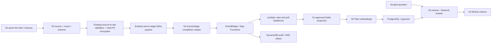

# AWSBEDROCKAI · Insurance RAG data product

A working reference implementation that adds grounded claims search to an existing AWS / Databricks insurance data platform. The local demo runs without cloud credentials; the cloud path uses staged Delta tables, Bedrock Titan embeddings, PostgreSQL/pgvector retrieval and a configurable Bedrock chat model.

**Status:** runnable local product plus cloud deployment assets. AWS/Databricks deployment and live model evaluation require your environment; this repository does not claim a production deployment or multi-terabyte benchmark.

## Try it in two minutes

Python 3.11 or later:

```sh
python -m venv .venv
# Windows: .venv\Scripts\activate
# macOS/Linux: source .venv/bin/activate
python -m pip install .
insurance-rag ingest data/synthetic_claims.json --expected-count 6 --batch-id demo-001
insurance-rag query "flood claims"
insurance-rag query "collision" --product motor
python -m unittest discover -s tests -v
```

Six synthetic input records become five current claims. The older CLM-1001 record is replaced by its latest version. A flood query returns CLM-1002 with a source citation. The offline mode uses lexical retrieval and returns evidence directly; it does not pretend to call an LLM. Search results are samples, not exhaustive financial totals.

## Architecture



The upstream Ab Initio, Autosys, Vault and raw-to-stage production jobs are integration boundaries, not recreated proprietary systems. This product begins at approved staged data. The local adapter demonstrates count/schema validation, deterministic deduplication, row hashes, metadata, and durable upserts with SQLite. Production Delta staging remains owned by the existing platform.

## What is included

| Path | Purpose |
|---|---|
| `src/insurance_rag/` | Local data contract, retrieval CLI, Bedrock and pgvector adapters |
| `notebooks/01_chunk_delta_data.py` | Project approved fields from Delta; one structured claim per chunk |
| `notebooks/02_generate_embeddings.py` | Stream chunks, generate Titan v2 vectors, idempotently upsert |
| `notebooks/03_rag_query.py` | Operator query with evidence and source citations |
| `notebooks/04_mlflow_tracking.py` | Model, latency and retrieval metrics; no raw sensitive text |
| `cloud/handler.py` | Idempotent job submission and terminal-state polling |
| `cloud/query_handler.py` | Optional query API handler with verified JWT product scope |
| `terraform/` | EventBridge → Step Functions → Lambda; audit and notifications |
| `databricks.yml` | Two-task indexing job; query and tracking are interactive notebooks |
| `sql/init.sql` | 1024-dimensional pgvector schema and indexes |
| `tests/` | Offline contracts, reruns, scope filtering and mocked cloud behavior |

## Contract and retrieval boundaries

Required fields: `claim_id`, `policy_id`, `product`, `status`, `loss_type`, `amount`, `currency`, `updated_at`. IDs must be pseudonymous; categorical text must already be approved and sanitized upstream. Do not ingest names, addresses, medical details, raw claim narratives or Vault ciphertext into the RAG projection. Unknown columns are rejected by the local contract. The cloud notebook explicitly projects the allowlist.

`updated_at` must carry a timezone. The latest source version wins even when batches arrive out of order. Equal-time local records have a stable tie-breaker. Source documents retain claim IDs for citations. A claim is a bounded structured record, so a text splitter is unnecessary here; add token-aware splitting and child IDs before supporting long documents.

The optional API rejects calls without a verified JWT subject and `custom:product` entitlement. Only a configured API Gateway JWT authorizer should invoke it. The product filter is defense in depth, not a complete multi-tenant authorization system. Claim IDs are assumed globally unique. Never expose direct Lambda invocation to untrusted callers.

## Cloud setup

See [deployment guide](docs/DEPLOYMENT.md) for prerequisites, commands, event contract and operational limits. No cloud resource is created by installing or running the offline demo. CI validates code and Terraform; it never applies infrastructure automatically.

## Verification

```sh
python -m unittest discover -s tests -v
python -m compileall -q src cloud notebooks
terraform -chdir=terraform init -backend=false
terraform -chdir=terraform validate
```

Cloud adapters are tested with mocks locally. Run environment integration tests for IAM, network access, model availability, SQL migrations, Databricks permissions and retrieval quality before production use.

## API references

- [Bedrock Titan embeddings](https://docs.aws.amazon.com/bedrock/latest/userguide/model-parameters-titan-embed-text.html)
- [Databricks Jobs API](https://docs.databricks.com/api/jobs/v2/job)

The implementation uses Titan v2 with 1024 dimensions and Databricks run idempotency tokens. Choose an enabled, region-compatible chat model through configuration.
