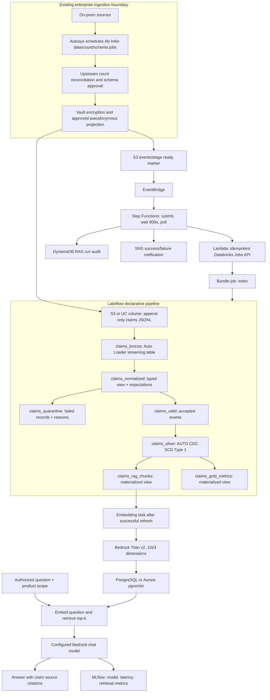

# AWSBEDROCKAI — Declarative insurance data platform and RAG

This project turns approved insurance claim events into current Delta tables, exact portfolio metrics and source-grounded answers. Databricks Asset Bundles (now called Declarative Automation Bundles) define deployment resources; Lakeflow Spark Declarative Pipelines define the data transformations and their dependencies.

**Implementation status:** the offline application runs without cloud credentials. The repository includes a metadata-driven Lakeflow pipeline, bundle-managed job, Bedrock/pgvector adapters, AWS orchestration and automated tests. Cloud execution requires your Databricks workspace, AWS permissions and database. Validation of source/configuration is not a claim that the pipeline has run in your cloud account.

## 1. Project architecture



### Responsibilities and boundaries

| Component | Responsibility | What it does not do |
|---|---|---|
| Existing ingestion platform | Ab Initio/Autosys extraction, count-file reconciliation, Vault protection and readiness marker | These proprietary upstream jobs are not recreated here |
| Asset Bundle | Declares pipeline/job resources, source libraries, variables, targets, permissions and run identity | Does not provision AWS networking or secrets |
| Lakeflow pipeline | Discovers files, checks records, quarantines failures, resolves claim state and refreshes derived views | Never calls Bedrock, writes directly to pgvector or sends notifications |
| Downstream embedding job | Reads committed RAG documents, calls Titan and upserts pgvector | Is not inside a declarative dataset function |
| Terraform | EventBridge, Step Functions, Lambda, DynamoDB audit, SNS and IAM | Does not create the Databricks workspace, database or upstream jobs |
| Query layer | Product-scoped retrieval, grounded model response and source references | Does not approve claims or calculate exhaustive totals from retrieved samples |

The `events/stage/` marker prefix is retained for compatibility with the original platform. Its meaning here is **approved landing files are ready**. Point the bundle at the approved append-only export prefix, not a Delta table directory or the marker directory. Upstream can export approved staged updates there. A manual `bundle run` also starts the workflow without AWS orchestration.

## 2. How one batch works, step by step

1. **Extract and approve.** The upstream scheduler produces data, count and schema outputs. Its existing controls reconcile counts and protect PII before publication. The pipeline in this repository performs row-level checks; it does not read count/schema sidecars.
2. **Publish immutable files.** Write newline-delimited JSON into `<landing_path>/claims/`. Each line is a complete claim state with a pseudonymous claim ID, approved categorical fields, amount, currency and source timestamp. Publish new files for updates; do not overwrite old objects.
3. **Signal readiness.** After the files are committed, write a `.json` marker beneath the configured AWS bucket's `events/stage/` prefix. The marker contents are not executed or used to choose arbitrary tables.
4. **Start once per marker version.** EventBridge starts Step Functions. Lambda hashes the bucket/key/version (or sequencer) into a Databricks idempotency token. Repeated delivery of that event resolves to the same job run.
5. **Refresh the pipeline.** The bundle job runs its `refresh_pipeline` task with `full_refresh: false`. Auto Loader uses pipeline-managed checkpoints to discover new files and maintain incremental ingestion. A new deployment/checkpoint may replay files; stable claim keys and source sequencing protect current state.
6. **Read bronze safely.** `claims_bronze` reads source fields as strings and retains malformed/rescued data plus source-file lineage. Unexpected fields do not silently become embedding fields.
7. **Normalize and measure quality.** `claims_normalized` uses `try_cast` for decimal amounts and timestamps, sets metadata and hashes the canonical business payload. Expectations record rule pass/fail metrics. The same rules control both routing branches.
8. **Route invalid events.** Invalid amount, missing ID, naive timestamp, unapproved category or rescued schema content goes to `claims_quarantine` with `_quality_failures`. SQL NULL is explicitly treated as invalid, so a record cannot disappear between the valid and quarantine branches.
9. **Maintain current state.** `create_auto_cdc_flow` writes `claims_silver` as SCD Type 1, keyed by `claim_id`. A source `updated_at`, then stable row hash, then source path determine event order. Older arrivals cannot revert newer claim data. Hash/path tie-breakers are deterministic fallbacks; a genuine upstream sequence number is preferable when same-timestamp ordering has business meaning.
10. **Refresh useful outputs.** `claims_rag_chunks` projects only approved business columns, a row hash and bounded text. `claims_gold_metrics` computes exact claim counts and amount totals by product, status and currency. It never adds different currencies together.
11. **Generate embeddings.** Only after pipeline success, the `embed` task reads the current RAG view and calls Titan. It upserts vectors keyed by claim ID, preserving newer timestamps and the pipeline's row-hash ordering. The job's `batch_id` is an audit label, not a filter on the current-state view.
12. **Observe completion.** Step Functions polls every 15 minutes. Lambda writes the RAG run status to DynamoDB; SNS publishes success or failure. Upstream raw/stage audit records remain the upstream platform's responsibility.
13. **Answer questions.** The query adapter embeds a question, retrieves product-scoped evidence, and asks the configured Bedrock model to answer with claim citations. Empty evidence returns an insufficient-evidence answer without calling the chat model. MLflow records metrics without logging raw questions, answers or evidence.

## 3. Dataset graph and outputs

| Dataset | Type | Contents / purpose |
|---|---|---|
| `claims_bronze` | Streaming table | All landed records, rescued fields, corrupt payload indicators and file lineage |
| `claims_normalized` | Temporary streaming view | Typed fields, expectation metrics and ingestion metadata |
| `claims_valid` | Temporary streaming view | Only records passing every declared rule |
| `claims_quarantine` | Streaming table | Failed records and comma-separated failure-rule names |
| `claims_silver` | Streaming table maintained by AUTO CDC | Latest complete valid version of each claim |
| `claims_rag_chunks` | Materialized view | Pseudonymous documents for embeddings |
| `claims_gold_metrics` | Materialized view | Exact current counts/totals grouped by product/status/currency |
| `insurance_pipeline_events` | Pipeline event log | Update progress, lineage and data-quality metrics |

Invalid new updates do not overwrite existing valid silver rows. Quarantine operators must correct the source and publish a new valid event with the appropriate sequence. The initial implementation supports full-record upserts, not partial updates or deletion events. A delete operation must not be silently converted into an upsert; implement tombstones end to end before adding deletion feeds.

## 4. Bundle properties and deployment layout

```text
AWSBEDROCKAI/
├── databricks.yml                       # Bundle identity, includes, variables, dev/prod
├── resources/
│   ├── insurance.pipeline.yml           # Serverless Lakeflow resource
│   └── insurance.job.yml                # Pipeline refresh → embedding task
├── pipelines/
│   ├── config/datasets.json             # Reviewed schema, keys, sequencing, categories
│   ├── framework.py                     # Contract validation + pure transformations
│   └── transformations/insurance.py     # Declarative dataset and AUTO CDC definitions
├── config/variable-overrides.json.example
├── notebooks/02_generate_embeddings.py
├── notebooks/03_rag_query.py
├── notebooks/04_mlflow_tracking.py
├── src/insurance_rag/                   # Offline application and cloud adapters
├── cloud/                              # AWS trigger/poll and optional query handlers
├── terraform/                          # AWS orchestration resources
├── sql/init.sql                        # pgvector schema + upgrade migration
├── scripts/                            # Bundle schema check + JSONL fixture generator
├── tests/                              # Unit tests and real Spark transformation tests
└── .github/workflows/ci.yml
```

| Bundle property | How this project uses it |
|---|---|
| `bundle.name`, `databricks_cli_version` | Stable deployment identity and tested CLI compatibility floor |
| `include` | Keeps pipeline and job YAML modular under `resources/` |
| `variables` | Supplies catalog, schema, landing prefix, embedding cluster and secret references |
| `workspace.root_path` | Per-user dev workspace directory; stable shared prod directory |
| `artifacts` | Builds the Python wheel for the embedding task |
| `sync.exclude` | Keeps tests, Terraform, sample data, documentation and ZIPs out of deployed source sync |
| `targets.dev` | Development mode and pipeline development behavior |
| `targets.prod`, `run_as`, `permissions` | Production deployment with explicit service-principal identity |
| `resources.pipelines` | Serverless, triggered pipeline with `ADVANCED` edition for expectations/AUTO CDC |
| `catalog`, `schema` | Unity Catalog publication destinations, distinct for each target |
| `root_path`, `libraries.glob` | Makes the framework importable and loads only transformation definitions |
| `configuration` | Landing location and UTC timestamp semantics |
| `event_log` | Publishes pipeline operational events in the configured catalog/schema |
| `pipeline_task.pipeline_id` | References the bundle-created pipeline by resource ID |
| `depends_on` | Starts embeddings only after successful pipeline completion |
| `queue`, `max_concurrent_runs` | Serializes full workflow runs to avoid overlapping vector writers |
| `libraries`, `notebook_task.base_parameters` | Installs the wheel/cloud dependencies and injects table/secret references |

The framework is metadata-driven for **reviewed claim-shaped feeds**, not arbitrary schemas. Change `pipelines/config/datasets.json` to extend approved categories or declare another claim-shaped feed. Each registered feed gets its own graph. Wire a corresponding embedding task/table deliberately; the supplied indexing job consumes `claims_rag_chunks`. Schema/PII changes require review and code changes, not automatic model approval.

## 5. Local demo

Python 3.11 or later, no AWS account required:

```sh
python -m venv .venv
# Windows: .venv\Scripts\activate
# macOS/Linux: source .venv/bin/activate
python -m pip install .
insurance-rag ingest data/synthetic_claims.json --expected-count 6 --batch-id demo-001
insurance-rag query "flood claims"
insurance-rag query "collision" --product motor
python -m unittest discover -s tests -v
```

The six supplied synthetic events represent five unique claims. `CLM-1001` changes from open to review. A flood query cites `CLM-1002`. This local application uses SQLite and lexical retrieval; it does not emulate Lakeflow checkpoints or pretend to call Bedrock.

Create an Auto Loader fixture (JSONL, not the demo's JSON array):

```sh
python scripts/create_landing_fixture.py work/claims-demo.jsonl
# Upload to <landing_path>/claims/claims-demo.jsonl with your approved cloud tooling.
```

## 6. Deploy the declarative pipeline

Prerequisites: Databricks CLI 1.17+, an authenticated workspace profile, Unity Catalog, serverless Lakeflow availability, target catalog/schema privileges, an external location or UC volume with landing-file access, and a Bedrock-enabled embedding cluster. Set up pgvector and restricted DSN secrets separately. No secret values belong in bundle YAML.

1. Copy `config/variable-overrides.json.example` to `.databricks/bundle/dev/variable-overrides.json` and replace every example value. Create parent directories as needed. Give each developer an isolated schema.
2. Authenticate using your organization's Databricks OAuth/profile flow. Do not paste tokens into Git.
3. Run the SQL migration in `sql/init.sql`, including the `source_order_key` upgrade for existing databases.
4. Validate, deploy and run:

```sh
databricks bundle validate -t dev --profile YOUR_DEV_PROFILE
databricks bundle deploy -t dev --profile YOUR_DEV_PROFILE
databricks bundle run -t dev --profile YOUR_DEV_PROFILE index
```

For production, supply `.databricks/bundle/prod/variable-overrides.json` with a separate catalog/schema/landing prefix, the appropriate embedding cluster and `deployer_sp`. Grant that principal the required Unity Catalog, pipeline, compute, secret and AWS permissions. Then run the same commands with `-t prod --profile YOUR_PROD_PROFILE`. The bundle declares the identity; it does not grant upstream cloud or database access automatically.

The AWS Lambda must reference the deployed bundle **index job ID**, not the pipeline ID. Use the existing Terraform inputs to connect it. See [the deployment guide](docs/DEPLOYMENT.md) for IAM, event contracts and integration acceptance checks.

## 7. Data quality, security and recovery

- Claim and policy IDs must use the configured pseudonymous formats. Reviewed products, statuses, loss types and currencies are allowlisted. Free-form claim descriptions are deliberately excluded.
- Amounts are `decimal(18,2)` and non-negative. Invalid types, overflow, missing fields, naive timestamps, unexpected columns and malformed JSON route to quarantine.
- Bronze and quarantine may contain unexpected sensitive payloads in rescued/corrupt fields. Restrict their Unity Catalog permissions and retention. Only the reviewed RAG projection can reach Bedrock.
- Declarative functions only return DataFrames. They do not call `collect`, perform database writes, invoke models or send notifications. Those effects happen after the pipeline task succeeds.
- A malformed input record can be quarantined while valid records progress. A pipeline execution failure prevents the embedding task from starting. Infrastructure/model/database errors fail the job and are visible through AWS polling/audit.
- The optional API requires a verified JWT subject and product entitlement. Notebook query access relies on workspace permissions. Product scope is not a complete multi-tenant authorization design.
- The workflow polls every 900 seconds and times out after 24 hours. Add alarms for execution timeouts and delivery failures; a state-machine timeout does not take its failure catch branch.
- Do not full-refresh a production pipeline casually. It can replay retained source files and rebuild current tables. Confirm source retention and recovery requirements first.

## 8. Testing and practical limits

CI runs the stdlib test suite, real Spark transformation tests, merged bundle schema validation against the official Databricks CLI schema, Python compilation, the CLI smoke test and Terraform formatting/validation. Spark tests exercise typed amounts, timestamps, quality routing, stable hashes and exclusion of diagnostics from RAG text.

Schema validation is offline. `databricks bundle validate` additionally needs authenticated workspace settings. Auto Loader checkpoints, AUTO CDC execution, Unity Catalog grants, serverless compute, Bedrock and pgvector must be tested in your dev workspace; local Spark does not implement Databricks-specific AUTO CDC.

The embedding task currently scans the current RAG snapshot and embeds sequentially. It is suitable for a demonstrator, not a proven multi-terabyte service. Add hash-based embedding reuse, a durable work queue, rate limits and bulk writes before large-scale operation. Deletion propagation into pgvector is not implemented. Similarity thresholds and answer quality require evaluation with labeled questions. Exact financial totals come from `claims_gold_metrics` or governed SQL, not top-k RAG samples.

## 9. Official references

- [Develop pipelines with bundles](https://docs.databricks.com/aws/en/dev-tools/bundles/pipelines-tutorial)
- [Bundle resource properties](https://docs.databricks.com/aws/en/dev-tools/bundles/resources)
- [Lakeflow Python definitions](https://docs.databricks.com/aws/en/ldp/developer/python-dev)
- [AUTO CDC sequencing and upserts](https://docs.databricks.com/aws/en/ldp/developer/ldp-python-ref-apply-changes)
- [Bedrock Titan embeddings](https://docs.aws.amazon.com/bedrock/latest/userguide/model-parameters-titan-embed-text.html)
